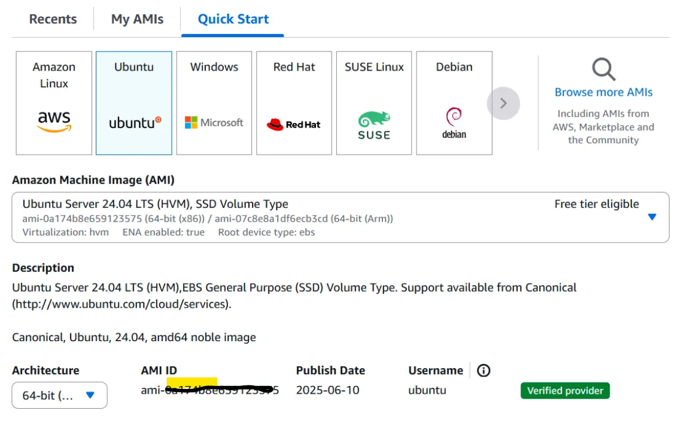

# InstallMongoDB.Ec2
Scripts and step-by-step instructions to install MongoDB on EC2 instances. These scripts facilitate quick and reliable deployment of MongoDB servers, ensuring consistent setup across environments.


### Requirenment 📝
- Aws account
- Import the public key used by the package management system

### Steps to create the instance 👣
- From Aws / EC2 / With the region selected.
- Create new instance -> Launch instances.
- Create new instance
- Select Quick Start -> Ubuntu and Ubuntu Server 24.04
- Ubuntu 24.04–8gb


### Steps to install mongodb 👣
1. Connect to the instance
```
curl -fsSL https://www.mongodb.org/static/pgp/server-8.0.asc | \
   sudo gpg -o /usr/share/keyrings/mongodb-server-8.0.gpg \
   --dearmor
```

2. Add sources
```
echo "deb [ arch=amd64,arm64 signed-by=/usr/share/keyrings/mongodb-server-8.0.gpg ] https://repo.mongodb.org/apt/ubuntu noble/mongodb-org/8.0 multiverse" | sudo tee /etc/apt/sources.list.d/mongodb-org-8.0.list
```

3. Reload local package database
```
sudo apt update
```

4. Install the MongoDB
```
sudo apt install -y mongodb-org
```

5. Mongodb version and run
```
mongod –version
sudo systemctl start mongod
```

6. If you didn’t get any errors and Mongo is already running, we can enable binIdP so we can connect by uploading our IP to the security group.
```
sudo nano /etc/mongod.conf
```

7. Replate the binIdP value 127.0.0.1 to 0.0.0.0


```
sudo systemctl restart mongod
```

8. Add your ip in the security group that has the associated instance.
9. If you already uploaded the IP, you can test the connection to the instance.

#### How to test if the instance and mongo are working correctly? ⁉️
1. Download https://robomongo.org/ to connect to the database.
2. With your Public IPv4 DNS
