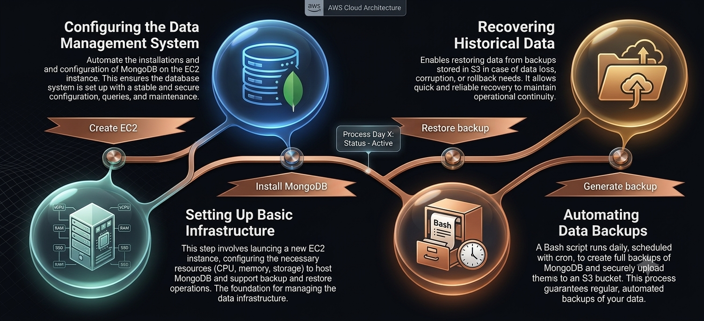

# Aws.Ec2.MongoDB.WithBackups.S3
Scripts to install MongoDB on EC2, generate backups, and restore them, storing backups in an S3 bucket. </br>
Covers the full lifecycle: installation, automated backup, and restore when needed.


#### Prerequisites 📄
Before using these scripts:
- **Create an EC2 instance** (e.g. from [AWS EC2](https://aws.amazon.com/ec2/)).
- **Minimum recommended size:** `t3.small`.
- **Minimum volume:** 30 GB.

#### Repository structure 🗂️
| Folder | Description |
|--------|-------------|
| **[1.InstallMongoDB.Ec2](1.InstallMongoDB.Ec2/)** | Steps and instructions to install MongoDB on an EC2 instance (Ubuntu). |
| **[2.GenerateBackup](2.GenerateBackup/)** | Script to generate backups with `mongodump` and upload them to S3. Includes logging, lock, and `--gzip` option. |
| **[3.RestoreBackup](3.RestoreBackup/)** | Script and steps to download a backup from S3 and restore into MongoDB with `mongorestore`. |

#### Typical workflow 🚀
1. Create the EC2 instance and meet the size/volume requirements.
2. Follow **[1.InstallMongoDB.Ec2](1.InstallMongoDB.Ec2/)** to install MongoDB.
3. Configure **[2.GenerateBackup](2.GenerateBackup/)** (S3 bucket, cron) for automated backups.
4. When needed, use **[3.RestoreBackup](3.RestoreBackup/)** to restore from S3.

#### Automation with cron 🕒
To run the backup automatically from the instance:
- **Production (daily):** every day at 5:00 AM  
  `0 5 * * * /home/ubuntu/generate-backup.sh --gzip > /dev/null 2>&1`
- **QA (weekly):** every Friday at 5:00 AM  
  `0 5 * * 5 /home/ubuntu/generate-backup.sh --gzip > /dev/null 2>&1`

Adjust the script path (`/home/ubuntu/generate-backup.sh`) to match where you placed it. </br>
More details in [2.GenerateBackup/README.md](2.GenerateBackup/README.md). </br>
Cron reference for Ubuntu: [Crontab.Script](https://github.com/agustinafassina/Crontab.Script).

#### Line endings (Windows → EC2) ⚠️
If you copy the `.sh` scripts from Windows to the EC2 instance, make sure they use **LF** line endings, not **CRLF**. With CRLF the script fails on Linux with an error like `/bin/bash^M: bad interpreter`. To fix it, run this on the instance:
```
sed -i 's/\r$//' *.sh
```

## ——— Español ———
Scripts para instalar MongoDB en EC2, generar backups y restaurarlos, guardando los backups en un bucket S3. Cubre todo el ciclo: instalacion, backup automatico y restauracion cuando haga falta.


#### Requisitos previos 📄
Antes de usar estos scripts:
- **Crear una instancia EC2** (por ejemplo desde [AWS EC2](https://aws.amazon.com/ec2/)).
- **Tamaño mínimo recomendado:** `t3.small`.
- **Volumen mínimo:** 30 GB.

#### Estructura del repositorio 🗂️
| Carpeta | Descripcion |
|---------|-------------|
| **[1.InstallMongoDB.Ec2](1.InstallMongoDB.Ec2/)** | Pasos e instrucciones para instalar MongoDB en una instancia EC2 (Ubuntu). |
| **[2.GenerateBackup](2.GenerateBackup/)** | Script para generar backups con `mongodump` y subirlos a S3. Incluye logging, lock y opcion `--gzip`. |
| **[3.RestoreBackup](3.RestoreBackup/)** | Script y pasos para bajar un backup desde S3 y restaurar en MongoDB con `mongorestore`. |

#### Flujo tipico 🚀
1. Crear la instancia EC2 y cumplir los requisitos de tamano/volumen.
2. Seguir **[1.InstallMongoDB.Ec2](1.InstallMongoDB.Ec2/)** para instalar MongoDB.
3. Configurar **[2.GenerateBackup](2.GenerateBackup/)** (bucket S3, cron) para backups automaticos.
4. Cuando haga falta, usar **[3.RestoreBackup](3.RestoreBackup/)** para restaurar desde S3.

#### Automatización con cron 🕒
Para ejecutar el backup de forma automatica desde la instancia:

- **Producción (diario):** todos los dias a las 5:00  
  `0 5 * * * /home/ubuntu/generate-backup.sh --gzip > /dev/null 2>&1`
- **QA (semanal):** todos los viernes a las 5:00  
  `0 5 * * 5 /home/ubuntu/generate-backup.sh --gzip > /dev/null 2>&1`

Ajusta la ruta del script (`/home/ubuntu/generate-backup.sh`) segun donde lo tengas. </br>
Mas detalles en [2.GenerateBackup/README.md](2.GenerateBackup/README.md). </br>
Referencia de cron en Ubuntu: [Crontab.Script](https://github.com/agustinafassina/Crontab.Script).

#### Saltos de línea (Windows → EC2) ⚠️
Si copiás los scripts `.sh` desde Windows a la instancia EC2, fijate que tengan saltos de línea **LF** y no **CRLF**. Con CRLF el script falla en Linux con un error tipo `/bin/bash^M: bad interpreter`. Para arreglarlo, corré en la instancia:
```
sed -i 's/\r$//' *.sh
```
